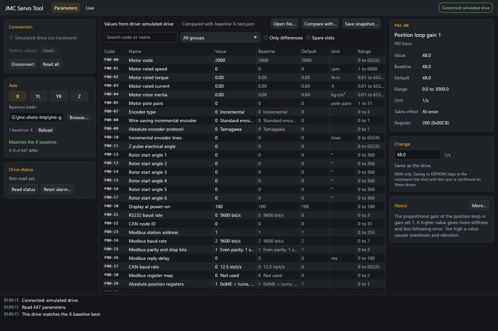
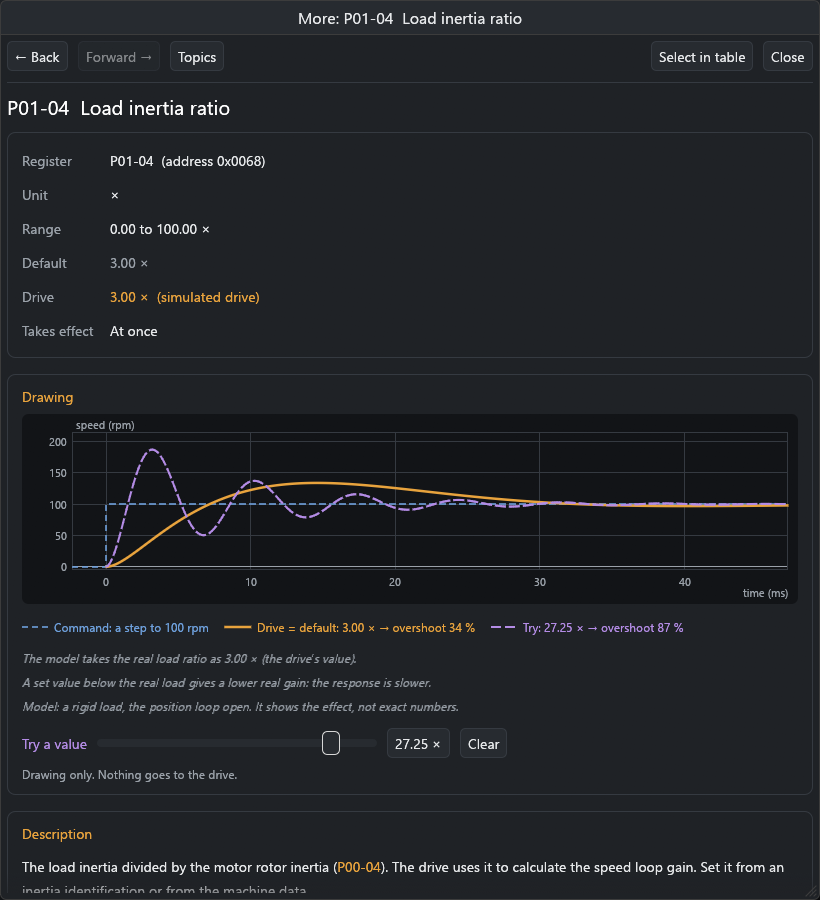

# JMC Servo Tool

A Windows tool for JMC JAND/JASD AC servo drives (model group 512). It reads, writes, saves and monitors the drive settings over the PC serial port of the drive. It is a replacement for JMC's PC tool (JmcServoPcControl 2.4.3), and it stays compatible with it.

It has two front ends:

- `jmc-servo-tool`: a window for people.
- `jmc`: a command-line tool for scripts and AI agents. Every command prints JSON.



> **Not affiliated with JMC.** This is an independent project. "JMC" is used only to name the drives that it works with.
>
> **This software changes the settings of motion control hardware.** A wrong setting can crash an axis, damage the machine or hurt someone. Use it at your own risk. Read [Safety](#safety) first.

## Status

The command-line tool and the window are built and tested against a simulated drive and against real JMC 2.4.3 export files. **They have not been run against a real drive yet.** The first bench checks on a real drive are the next step.

Planned: a local API, an MCP server for AI agents, and a bridge to LinuxCNC for motion tests and tuning.

## Features

- Read every parameter, compare the drive with a saved baseline or another file, and save snapshots.
- Safe writes: range checks, an axis check, a full backup first, and a read-back after each write. RAM by default.
- Live monitor: following error, speed, torque, load, position and bus voltage, with CSV export.
- Import and export JMC 2.4.3 parameter files. JMC 2.4.3 can load the files that this tool writes.
- A help window for every parameter, with drawings of its effect (see [Help pages](#help-pages-and-drawings)).
- Its own parameter table and help text, written for this project.

## Build

Rust 1.97.1 (pinned in `rust-toolchain.toml`). Windows 10 or 11.

```bash
cargo build --release
```

The programs are `target/release/jmc-servo-tool.exe` (the window) and `target/release/jmc.exe` (the command line).

## Connecting

- Connect a USB-serial (RS232) cable to the PC port of the drive. The tool talks to one drive at a time.
- Find the port and settings with `jmc ports`, then `jmc --port COM5 probe`. The probe tries the usual baud rates and framings and reports the one that the drive answers on.
- Set `JMC_PORT=COM5` to use that port by default.
- Every command works without a drive against the simulator: add `--sim`.

## The window

`jmc-servo-tool.exe` uses the same library as `jmc`, so it follows the same safety rules.

- **Connection** (left): serial port, baud, framing and station, or the simulated drive (optionally loaded from a snapshot or JMC export). **Find settings** tries the usual baud rates and framings. When it connects, it reads every parameter.
- **Axis** (left): choose the axis and the baselines folder. After each read, the window shows which baseline the drive matches best. A mismatch shows in red.
- **Drive status** (left): servo on, fault, warning and alarm registers. **Reset alarm** asks first: if servo-on is wired permanently on, the motor can start as soon as the alarm clears.
- **Parameters** tab: every parameter with its value, the baseline value (or another file, with **Compare with**), the default, the unit and the range. Differences are orange. Search, filter by group, or show only differences. **Open file** shows a snapshot or JMC export in place of the drive. **Save snapshot** saves what was read.
- **Change** (right): select a parameter, type or choose the new value, then click **Write to RAM**. A dialog shows the change first. The write uses the same sequence as `jmc write --axis`: read the whole drive, check that it matches the axis baseline, save a backup, write, read back.
- **About** (right): a short description of the selected parameter. **More...** opens its help page.
- **Live** tab: plots the monitor registers every 20 to 250 ms, with a window of 5 to 60 s. **Save CSV** saves the samples.
- Messages and the result of each write go to the log at the bottom. Settings are kept in `%LOCALAPPDATA%\JMC-Servo-Tool\gui.json`.

What the window does not do, on purpose:

- No EEPROM save. RAM writes only, until the save method is confirmed on a real drive. After that, use `jmc write --save --yes`.
- No writes to parameters that apply only after a power cycle. A power cycle clears RAM, so the write would do nothing.
- No writes to protected parameters, no writes without the axis check, and no writes while the live monitor runs or while it shows a file.

## Help pages and drawings

**More...** opens a help window for the selected parameter. Each page has:

- The facts: register address, unit, range, default, the value in the drive, and when a change applies.
- A drawing of what the parameter does. Examples: the step response of the speed loop, the frequency response of a filter or notch, a ramp, a limit or an alarm level. The drawing shows the value in the drive against the default. **Try a value** adds a third curve. It changes the drawing only; nothing goes to the drive.
- What the parameter does, its effect and how to set it, for the tuning parameters.
- Links. Each parameter code in the text opens that parameter's page. Back and Forward work like a browser. Topic pages explain how the parts work together: the control loops, the filters and the gain sets.



The drawings come from a simple model of the drive: a cascade of position and speed loops, first-order filters, notch filters and a rigid load. They show the direction and size of an effect, not exact numbers. Each drawing says so.

The pages are Markdown files in [docs/parameters](docs/parameters) and [docs/topics](docs/topics). They are built into the program. The text uses Simplified Technical English: short sentences, one meaning for each word. The tests check the text rules and that every link goes to a real page.

## Commands

| Command | What it does | Needs a drive |
|---|---|---|
| `ports` | List serial ports | no |
| `probe` | Find the baud rate and framing that the drive answers on | yes |
| `params [QUERY] [--group N] [--all]` | Search the parameter table | no |
| `info CODE` | One parameter in full: range, choices, description | no |
| `read CODE...` | Read parameters, for example `read P02-00 p3-9` | yes |
| `snapshot --out FILE [--axis A] [--note TEXT]` | Read all 447 parameters and save them as JSON | yes |
| `write CODE=VALUE... --axis A` | Write parameters (see [Safety](#safety)) | yes |
| `monitor [--count N] [--interval-ms MS]` | Live position, following error, speed, torque and bus voltage, one JSON line per sample | yes |
| `status` | Servo on, fault and warning flags, active alarm codes | yes |
| `reset-alarm --yes` | Clear the alarm of the drive | yes |
| `raw-read ADDR [COUNT]` | Read registers by address (decimal or 0x hex) | yes |
| `bench-read-size` | Find the largest block that the drive answers in one frame | yes |
| `import-xml FILE [--axis A] [--taken UTC]` | Make a snapshot from a JMC 2.4.3 export | no |
| `export-xml SNAPSHOT --out FILE` | Write a snapshot as a JMC 2.4.3 export | no |
| `diff A B` | Compare two snapshots or exports | no |
| `identify --baselines DIR [--file F]` | Find which axis this drive (or file) matches | yes, or `--file` |

Parameter codes can be typed loosely: `p2-0`, `P2-00` and `P02-00` are the same parameter. Values are in display units, as JMC shows them (`P02-00=52.0`, not the raw register value 520).

Global options: `--port`, `--baud`, `--framing` (8E1, 8N2, 8N1, 8O1), `--slave`, `--timeout-ms`, `--max-read`, `--compact` (one-line JSON), `--sim`, `--sim-from FILE`.

Errors go to stderr as `{"error": "..."}` with exit code 1.

### Environment variables

| Variable | Used for |
|---|---|
| `JMC_PORT` | Default for `--port` |
| `JMC_BASELINES` | Folder of baseline snapshots, used by `write` and `identify` |
| `JMC_BACKUP_DIR` | Where `write` saves the snapshot that it takes first (default `%LOCALAPPDATA%\JMC-Servo-Tool\backups`) |

## Safety

The drives move the axes of a machine. A wrong setting can crash an axis, rack a gantry or damage parts. So `write` is careful:

1. **RAM by default.** A plain write is lost at power-off. `--save` also writes to EEPROM, and it needs `--yes`. The EEPROM save sets bit 15 of the address, as JMC's tool does. This is not yet confirmed on a real drive.
2. **Axis check.** `--axis` is necessary. Before it writes, the tool reads every parameter and compares the drive with the saved baselines. If the drive looks like a different axis, nothing is written. `--no-identify-check` skips this check.
3. **Backup first.** Each write saves a full snapshot of the drive before it changes anything. A refused write saves nothing.
4. **Protected parameters are refused**, unless you give `--allow-protected`:
   - motor data and factory parameters
   - the serial settings P00-21 to P00-26 (a change drops the connection)
   - parameters that the table marks read-only
   - spare slots
   - Reserved registers are always refused.
5. **Range checks.** Each value is checked against the range in the table before anything is sent. A code that is given twice in one command is refused.
6. **Read-back.** Each write is read back. At the first failure, the tool stops and reports what it wrote and what it did not write.

## Snapshots and baselines

A snapshot is a JSON file: model, axis, the time it was taken (UTC), source, note, and the display value of every parameter. An imported JMC export keeps every value. An export writes a 19-column file that JMC 2.4.3 loads, with the same values and this project's text.

Keep one baseline snapshot for each axis in a folder, for example `snapshots/X/X-baseline.json`. Give the folder with `--baselines` or `JMC_BASELINES`. The search includes subfolders, but only snapshots that have an axis count as baselines.

## Simulator

`--sim` uses a simulated drive with factory values. `--sim-from FILE` loads a snapshot or JMC export into it. Every command works against it, so you can try a write without a drive:

```bash
jmc --sim-from X.json write P02-00=52.0 --axis X --baselines snapshots
```

## Compatibility with JMC 2.4.3

- The same serial protocol: Modbus RTU, with the parameter address = group × 100 + index.
- It imports the parameter files that JMC 2.4.3 exports.
- It exports files in the same 19-column layout, so JMC 2.4.3 can load them. The values and the columns that JMC reads are the same. The names and descriptions are this project's.

## Parameter table

[`crates/jmc-core/data/model512.toml`](crates/jmc-core/data/model512.toml) is this project's table for model 512. For each register it keeps the facts: address, limits, scaling, access level, when a change applies, and the choice values. The names, units, descriptions and choice labels are written for this project. No files from JMC are in this repository.

## Tests

```bash
cargo test --workspace
```

Two tests need files that are not in the repository:

- `JMC_EXPORTS_DIR`: a folder of JMC 2.4.3 exports. Each one must import and export again with the same values.
- `JMC512_XML`: the model 512 parameter file of JMC 2.4.3. The tests check that this project's table is never less careful than JMC's (access, limits, servo-off) and that exports have the columns that JMC reads.

The window tests draw frames without a window. To look at the window and the help pages as pictures (needs a GPU):

```bash
JMC_SHOTS=shots cargo test -p jmc-servo-tool more_window_pictures -- --ignored
```

## License

Mozilla Public License 2.0 (MPL-2.0). See [LICENSE](LICENSE).

You can use this tool, and build it into other projects, open or closed. If you change its files and give the result to others, those changed files stay under the MPL-2.0 and their source must be available.
